# Rapport d'usage de l'IA — TP1

> **Modèle utilisé** : Gemini 2.5 Flash / Claude 3.5 Sonnet (assistant Antigravity IDE)  
> **Contexte** : MIAGE M1 — Programmation Web 
> **Auteurs (Binôme)** : RAHARISON Leong Foc Sing Andhy, FOUILLOUD Valentin

---

## Mission 1 — Inscription, Connexion et Profil

---

### 1. Formulaires réactifs pour l’inscription et la connexion

- **Objectif** :  
  Construire les formulaires de connexion (`/login`) et d'inscription (`/register`) avec l'approche réactive d'Angular (`ReactiveFormsModule`, `FormGroup`, `FormControl`), en assurant un typage strict et une liaison propre avec le template HTML.

- **Prompt principal** :  
  > *« Je veux que tu me fasses la partie formulaires réactifs pour l'inscription et la connexion qui se trouve dans le fichier sujet_etudiant_tp1.md. J'aimerais que tu crées les formulaires de connexion d'inscription, qu'ils soient reliés au HTML et qu'ils gèrent le clic sur le bouton de validation»*

- **Plan proposé par l'agent** :  
  1. Importer `ReactiveFormsModule` dans les composants standalone [`LoginPageComponent`](frontend-starter/src/app/components/login-page/login-page.ts) et [`RegisterPageComponent`](frontend-starter/src/app/components/register-page/register-page.ts).
  2. Déclarer des `FormGroup` fortement typés avec l'option `{ nonNullable: true }` sur chaque `FormControl`.
  3. Relier les contrôles dans les templates via la directive `[formGroup]="form"` et les attributs `formControlName`.
  4. Intercepter la soumission `(ngSubmit)="submit()"` en vérifiant `this.form.invalid`, et déclencher `this.form.markAllAsTouched()` pour révéler les erreurs si l'utilisateur soumet un formulaire incomplet.

- **Vérifications réalisées par le binôme** :  
  - Saisie de données dans les champs et observation de la mise à jour réactive des valeurs.
  - Vérification dans les Angular DevTools que les contrôles de formulaire changent bien d'état (`pristine` → `dirty`, `untouched` → `touched`).
  - Test de soumission à vide : la requête HTTP n'est pas envoyée tant que le formulaire est invalide.

- **Erreurs ou propositions rejetées** :  
  - Rejet de l'approche *Template-driven Forms* (`[(ngModel)]` / `FormsModule`) qui mélange la logique de validation avec le template HTML et complique les tests unitaires.

- **Fichiers effectivement modifiés** :  
  - [`frontend-starter/src/app/components/login-page/login-page.ts`](frontend-starter/src/app/components/login-page/login-page.ts)
  - [`frontend-starter/src/app/components/login-page/login-page.html`](frontend-starter/src/app/components/login-page/login-page.html)
  - [`frontend-starter/src/app/components/register-page/register-page.ts`](frontend-starter/src/app/components/register-page/register-page.ts)
  - [`frontend-starter/src/app/components/register-page/register-page.html`](frontend-starter/src/app/components/register-page/register-page.html)

- **Preuve de fonctionnement** :  
  - Formulaires fonctionnels avec extraction typée des données via `this.form.getRawValue()`. Bouton de soumission désactivé pendant le chargement (`[disabled]="loading()"`).

  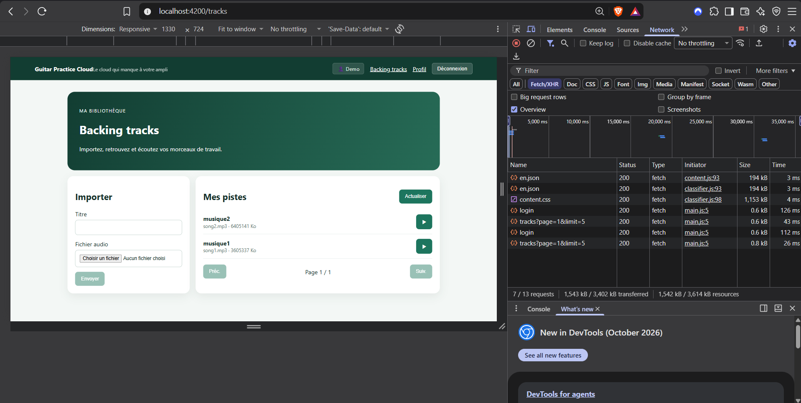
  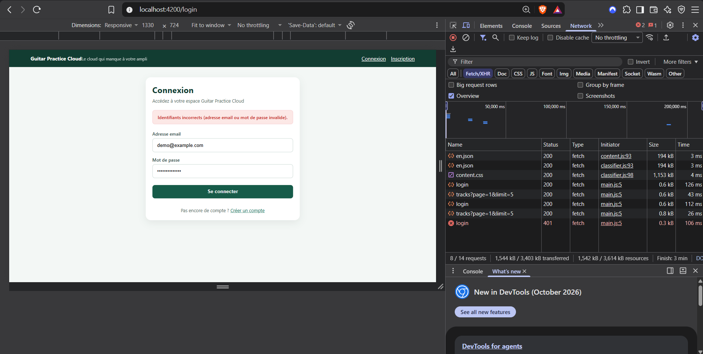
  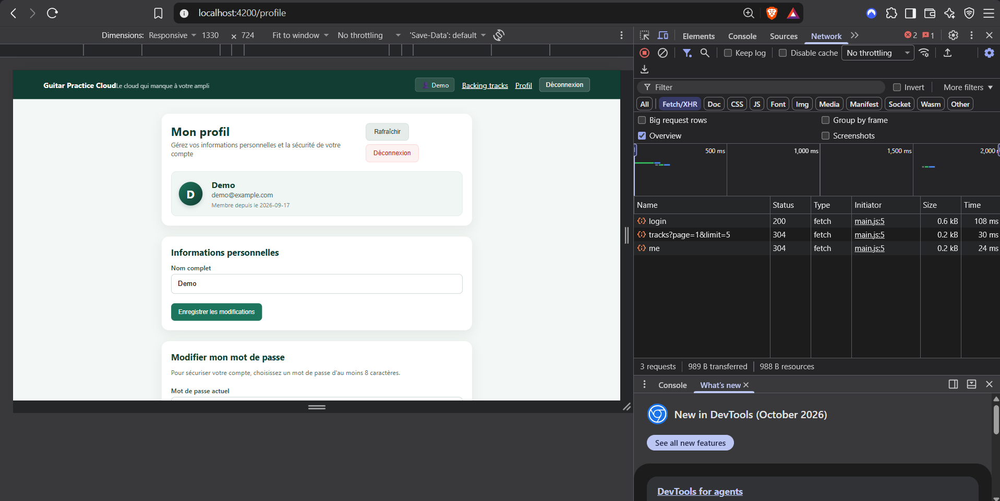

---

### 2. Validations et messages d'erreur compréhensibles

- **Objectif** :  
  Mettre en place des validateurs synchrones stricts respectant les règles du backend (nom $\ge$ 2 caractères, mot de passe $\ge$ 8 caractères, format email valide) et afficher des messages d'erreur clairs, compréhensibles et contextualisés (erreurs de saisie et retours HTTP de l'API).

- **Prompt principal** :  
  > *« Configure les validations des formulaires avec les validateurs Angular natifs, ajoute également une autre validation pour la correspondance des mots de passe, et affiches des messages d'erreurs compréhensible par tout le monde sous les champs touchés»*

- **Plan proposé par l'agent** :  
  1. Configurer les validateurs Angular natifs : `Validators.required`, `Validators.email`, `Validators.minLength(2)` pour le nom, `Validators.minLength(8)` pour le mot de passe.
  2. Créer une fonction de validation personnalisée (`passwordMatchValidator`) pour vérifier que le mot de passe et sa confirmation correspondent.
  3. Dans le HTML, conditionner l'affichage des erreurs avec la syntaxe de flux `@if (form.controls.field.touched && form.controls.field.hasError('...'))` pour ne pas agresser l'utilisateur avant qu'il n'ait interagi avec le champ.
  4. Créer des bannières d'alerte stylisées (`.alert-error`) pour traduire les codes HTTP retournés par le backend (`400 Bad Request`, `401 Unauthorized`, `409 Conflict`, `0 Erreur réseau`).
  5. Ajouter des retours visuels CSS (`.is-invalid`, bordure rouge) sur les champs en défaut.

- **Vérifications réalisées par le binôme** :  
  - Saisie d'un email malformé (`test@`) : le message *« Veuillez renseigner une adresse email valide »* s'affiche dès la perte de focus.
  - Saisie d'un mot de passe de moins de 8 caractères : le message *« Le mot de passe doit comporter au moins 8 caractères »* apparaît immédiatement.
  - Saisie de deux mots de passe différents lors de l'inscription : le message *« Les mots de passe ne correspondent pas »* bloque la validation.
  - Tentative d'inscription avec une adresse déjà existante (`demo@example.com`) : réception du code HTTP 409 et affichage de la bannière *« Cette adresse email est déjà utilisée par un autre compte »*.

- **Erreurs ou propositions rejetées** :  
  - Rejet d'un affichage des erreurs dès l'arrivée sur la page (`form.invalid` seul) : l'état `touched` a été rendu obligatoire pour préserver une expérience utilisateur de qualité.
  - Rejet de messages d'erreur génériques de type « Erreur » au profit de phrases explicites guidant l'utilisateur.

- **Fichiers effectivement modifiés** :  
  - [`frontend-starter/src/app/components/login-page/login-page.ts`](frontend-starter/src/app/components/login-page/login-page.ts)
  - [`frontend-starter/src/app/components/login-page/login-page.html`](frontend-starter/src/app/components/login-page/login-page.html)
  - [`frontend-starter/src/app/components/login-page/login-page.css`](frontend-starter/src/app/components/login-page/login-page.css)
  - [`frontend-starter/src/app/components/register-page/register-page.ts`](frontend-starter/src/app/components/register-page/register-page.ts)
  - [`frontend-starter/src/app/components/register-page/register-page.html`](frontend-starter/src/app/components/register-page/register-page.html)
  - [`frontend-starter/src/app/components/register-page/register-page.css`](frontend-starter/src/app/components/register-page/register-page.css)

- **Preuve de fonctionnement** :  
  - Messages d'erreur explicites sous les champs lors de saisies invalides ; coloration rouge immédiate ; messages d'erreur HTTP traduits et affichés dans les bannières d'alerte.

  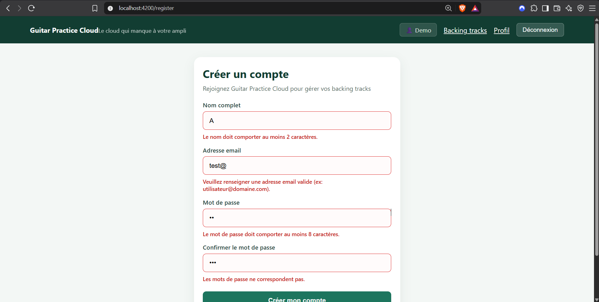

---

### 3. Appels de `/api/auth/register` et `/api/auth/login`

- **Objectif** :  
  Connecter les formulaires de l'interface utilisateur à l'API Express via [`AuthService`](frontend-starter/src/app/shared/services/auth.service.ts), en utilisant `HttpClient` dans le service et `inject()` dans les composants, conformément à `API_CONTRACT.md`.

- **Prompt principal** :  
  > *« Relie les formulaire à l'API en créant les méthodes login et register dans AuthService avec HttpClient, puis appelle les méthodes depuis les composants à l'aide d' inject() en gérant les états de chargement et les erreurs»*

- **Plan proposé par l'agent** :  
  1. Respecter la séparation des couches : ne jamais injecter `HttpClient` directement dans les composants ; toutes les requêtes HTTP doivent transiter par [`AuthService`](frontend-starter/src/app/shared/services/auth.service.ts).
  2. Implémenter les méthodes `login(email, password)` et `register(name, email, password)` renvoyant des `Observable<AuthResponse>`.
  3. Utiliser l'opérateur RxJS `tap()` pour déclencher les effets de bord (stockage de l'authentification) avant la notification au composant.
  4. Dans les composants, souscrire (`.subscribe()`) aux méthodes du service, gérer l'état de chargement (`loading.set(false)`), afficher les erreurs éventuelles ou rediriger (`router.navigateByUrl('/tracks')` ou `'/profile'`).
  5. Nettoyer les saisies avec `.trim()` sur les emails et noms pour éviter les espaces invisibles.

- **Vérifications réalisées par le binôme** :  
  - Test dans l'onglet **Network (Réseau)** des DevTools du navigateur avec le filtre **Fetch/XHR** :
    - Clic sur « Se connecter » : émission d'une requête HTTP `POST http://localhost:4200/api/auth/login`.
    - Code statut HTTP retourné : `200 OK`.
    - Corps de la réponse JSON vérifié : `{ "token": "...", "user": { "id": "...", "name": "Demo", "email": "demo@example.com" } }`.
  - Inscription d'un nouvel utilisateur : émission d'une requête `POST http://localhost:4200/api/auth/register` avec statut `201 Created`.
  - Redirection automatique vers la bibliothèque de backing tracks (`/tracks`) ou la page de profil (`/profile`).

- **Erreurs ou propositions rejetées** :  
  - Rejet de l'injection directe de `HttpClient` dans `LoginPageComponent` ou `RegisterPageComponent` (violation du principe de responsabilité unique et du sujet TP1).

- **Fichiers effectivement modifiés** :  
  - [`frontend-starter/src/app/shared/services/auth.service.ts`](frontend-starter/src/app/shared/services/auth.service.ts)
  - [`frontend-starter/src/app/components/login-page/login-page.ts`](frontend-starter/src/app/components/login-page/login-page.ts)
  - [`frontend-starter/src/app/components/register-page/register-page.ts`](frontend-starter/src/app/components/register-page/register-page.ts)

- **Preuve de fonctionnement** :  
  - Requêtes observables dans l'onglet Network (statuts 200 et 201) ; mise à jour instantanée du composant et redirection vers les routes protégées.

  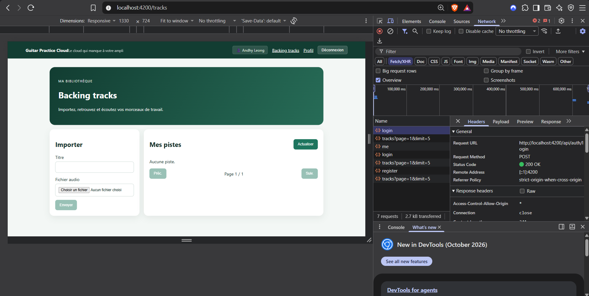

---

### 4. Sauvegarde du JWT côté navigateur, sans jamais l’afficher dans les logs

- **Objectif** :  
  Conserver le jeton JWT côté navigateur afin de maintenir la session utilisateur active (survivre à un rafraîchissement F5 de la page), tout en respectant la consigne stricte de sécurité interdisant d'imprimer la valeur du token dans la console ou les fichiers de log.

- **Prompt principal** :  
  > *« Je veux que tu me fasses la partie sauvegarde du JWT côté navigateur, sans jamais l'afficher dans les logs qui se trouve dans le fichier sujet_etudiant_tp1.md. J'aimerais qu'on sauvegarde le token dans le localStorage et dans l'application pour rester connecté même après un rafraichissement, sans jamais l'afficher dans le console, et qu'on le supprime quand on se déconnecte »*

- **Plan proposé par l'agent** :  
  1. Centraliser la clé de stockage sous une constante dédiée (`const TOKEN_STORAGE_KEY = 'gpc_token'`).
  2. Dans la méthode privée `storeAuthentication(response: AuthResponse)` de [`AuthService`](frontend-starter/src/app/shared/services/auth.service.ts) :
     - Écrire le token dans le stockage navigateur : `localStorage.setItem(TOKEN_STORAGE_KEY, response.token)`.
     - Synchroniser le signal Angular réactif : `this.token.set(response.token)`.
     - Synchroniser les données publiques de l'utilisateur : `this.currentUser.set(response.user)`.
  3. À l'initialisation du service, initialiser le signal à partir du stockage : `readonly token = signal<string | null>(localStorage.getItem(TOKEN_STORAGE_KEY))`.
  4. Lors de la déconnexion (`logout()`), supprimer l'entrée : `localStorage.removeItem(TOKEN_STORAGE_KEY)` et remettre les signaux à `null`.
  5. Vérifier l'intégralité du code frontend pour s'assurer qu'aucun `console.log()` ou `console.debug()` n'affiche le token JWT ou le mot de passe.

- **Vérifications réalisées par le binôme** :  
  - **Vérification du stockage** : DevTools > onglet **Application** > rubrique **Storage** > **Local Storage** (`http://localhost:4200`) : la clé `gpc_token` contient bien la chaîne JWT (format `header.payload.signature`).
  - **Vérification de la sécurité des logs** : DevTools > onglet **Console** : seuls des messages discrets sans donnée sensible sont émis (`[LoginPage] Connexion réussie`, `[RegisterPage] Inscription réussie`). Aucune valeur de JWT n'apparaît.
  - **Test de persistance** : Rafraîchissement de la page (`F5`) sur la route `/tracks` : la session reste ouverte, l'utilisateur n'est pas renvoyé vers `/login`.
  - **Test de déconnexion** : Clic sur « Déconnexion » : la clé `gpc_token` disparaît immédiatement du `localStorage`, et l'accès aux routes protégées est de nouveau bloqué par le guard [`authGuard`](frontend-starter/src/app/shared/guards/auth.guard.ts).

- **Erreurs ou propositions rejetées** :  
  - Rejet de l'affichage de l'objet de réponse complet dans la console (ex: `console.log(response)`), car il contient le champ sensible `token`.
  - Rejet du stockage en simple variable mémoire JavaScript (qui réinitialiserait la session à chaque rafraîchissement d'onglet).

- **Fichiers effectivement modifiés** :  
  - [`frontend-starter/src/app/shared/services/auth.service.ts`](frontend-starter/src/app/shared/services/auth.service.ts)
  - [`frontend-starter/src/app/components/login-page/login-page.ts`](frontend-starter/src/app/components/login-page/login-page.ts)
  - [`frontend-starter/src/app/components/register-page/register-page.ts`](frontend-starter/src/app/components/register-page/register-page.ts)

- **Preuve de fonctionnement** :  
  - Token visible et persistant dans l'onglet **Application > Local Storage** ; console DevTools exempte de tout log de token.

    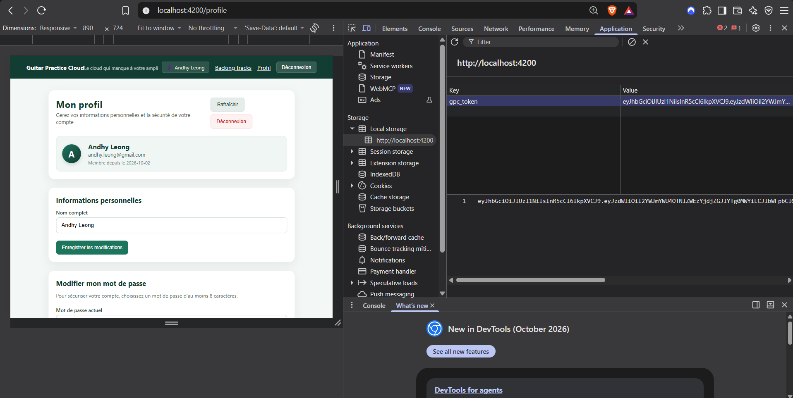

---

### 5. Mise à jour du Signal `currentUser`

- **Objectif** :  
  Centraliser et gérer l'identité de l'utilisateur connecté de façon réactive dans toute l'application via le Signal Angular `readonly currentUser = signal<User | null>(null)`, en assurant sa mise à jour automatique lors de la connexion, de l'inscription, de la lecture du profil (`GET /api/users/me`), de la mise à jour du nom (`PUT /api/users/me`), et de la déconnexion.

- **Prompt principal** :  
  > *« Je veux que tu me fasses la partie mise à jour du Signal `currentUser` qui se trouve dans le fichier sujet_etudiant_tp1.md. J'aimerais qu'on puisse voir le nom de l'utilisateur en haut de l'écran dans le head, qu'il se mette à jour quand on modifie son compte ou qu'on se déconnecte, et qu'il recharge le profil automatiquement si on fait un rafraichissement »*

- **Plan proposé par l'agent** :  
  1. Définir le signal réactif `readonly currentUser = signal<User | null>(null)` dans [`AuthService`](frontend-starter/src/app/shared/services/auth.service.ts) en tant que source unique de vérité (*Single Source of Truth*).
  2. Mettre à jour la valeur du signal avec `.set(...)` aux 5 moments clés du cycle de vie :
     - **Connexion** (`login`) : `this.currentUser.set(response.user)`.
     - **Inscription** (`register`) : `this.currentUser.set(response.user)`.
     - **Chargement du profil** (`profile()`) : `.pipe(tap((user) => this.currentUser.set(user)))`.
     - **Modification du profil** (`update(name)`) : `.pipe(tap((user) => this.currentUser.set(user)))` pour refléter immédiatement le nouveau nom renvoyé par le backend.
     - **Déconnexion** (`logout()`) : `this.currentUser.set(null)`.
  3. Mettre en place la **réhydratation au rechargement** dans [`AppComponent`](frontend-starter/src/app/components/app/app.ts) : si un token existe dans `localStorage` mais que `currentUser()` est null (suite à un rafraîchissement F5), déclencher un appel silencieux à `auth.profile()` pour restaurer le profil en mémoire.
  4. Consommer le signal dans les templates avec la syntaxe réactive moderne `@if (auth.currentUser(); as user)` dans l'en-tête de navigation ([`app.html`](frontend-starter/src/app/components/app/app.html)) et sur la page de profil ([`profile-page.html`](frontend-starter/src/app/components/profile-page/profile-page.html)).

- **Vérifications réalisées par le binôme** :  
  - **Propagation instantanée lors de la connexion** : Après saisie des identifiants et clic sur « Se connecter », la barre de navigation affiche immédiatement le prénom et nom (`👤 Demo`) sans aucun rechargement de page.
  - **Propagation instantanée lors de la modification du nom** : Sur `/profile`, modification du nom en « Valentin F. » et clic sur « Enregistrer » : le nom est mis à jour en temps réel à la fois dans le badge du profil ET dans la barre de navigation en haut de l'écran, démontrant la puissance de la réactivité synchrone du signal.
  - **Pérennité au rafraîchissement (F5)** : Rafraîchissement de la page : le constructeur de [`AppComponent`](frontend-starter/src/app/components/app/app.ts) réhydrate `currentUser`, l'interface conserve le nom sans repasser par un état déconnecté.
  - **Nettoyage lors de la déconnexion** : Clic sur « Déconnexion » : `currentUser` repasse immédiatement à `null`, le header masque le nom et affiche à nouveau les liens de connexion/inscription.

- **Erreurs ou propositions rejetées** :  
  - Rejet de l'ancien modèle RxJS `BehaviorSubject` avec pipe `async` (`currentUser$ | async`) : les Signals natifs d'Angular offrent une granularité plus fine (*fine-grained reactivity*), ne nécessitent pas de désouscription manuelle pour éviter les fuites de mémoire, et allègent grandement la syntaxe des templates.
  - Rejet de la duplication d'état : aucun composant ne stocke une copie locale de l'objet utilisateur, ils lisent tous directement le signal exposé par [`AuthService`](frontend-starter/src/app/shared/services/auth.service.ts).

- **Fichiers effectivement modifiés** :  
  - [`frontend-starter/src/app/shared/services/auth.service.ts`](frontend-starter/src/app/shared/services/auth.service.ts)
  - [`frontend-starter/src/app/components/app/app.ts`](frontend-starter/src/app/components/app/app.ts)
  - [`frontend-starter/src/app/components/app/app.html`](frontend-starter/src/app/components/app/app.html)
  - [`frontend-starter/src/app/components/app/app.css`](frontend-starter/src/app/components/app/app.css)
  - [`frontend-starter/src/app/components/profile-page/profile-page.ts`](frontend-starter/src/app/components/profile-page/profile-page.ts)
  - [`frontend-starter/src/app/components/profile-page/profile-page.html`](frontend-starter/src/app/components/profile-page/profile-page.html)

- **Preuve de fonctionnement** :  
  - Nom affiché en direct dans la barre de navigation (`👤 Nom`) dès la connexion.
  - Synchronisation bidirectionnelle immédiate entre la page profil et l'en-tête lors d'une mise à jour du nom.
  - Disparition instantanée de toutes les informations utilisateur lors d'un clic sur « Déconnexion ».

  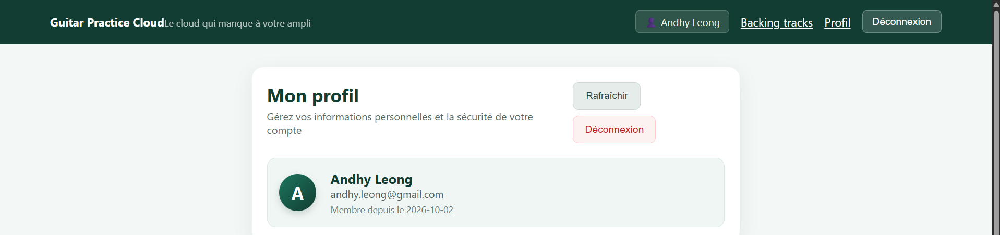

---

### 6. Redirection après une connexion ou une inscription réussie

- **Objectif** :  
  Assurer une redirection fluide et cohérente de l'utilisateur vers la page principale de l'application (la bibliothèque de backing tracks `/tracks`) immédiatement après une connexion réussie (`/login`) ou une inscription réussie (`/register`), en tirant parti du routeur Angular (`Router.navigateByUrl`).

- **Prompt principal** :  
  > *« je veux que tu me fasses la partie rediction après une connexion ou une inscription réussite qui se trouve dans le fichier sujet_etudiant_tp1.md  
  > j'aimerais qu'après une connexion réussie et/ou une inscription réussi, tu me rediriges directement sur la page d'accueil avec la liste de toutes mes musiques (la page backing tracks) »*

- **Plan proposé par l'agent** :  
  1. Injecter le service `Router` dans les composants [`LoginPageComponent`](frontend-starter/src/app/components/login-page/login-page.ts) et [`RegisterPageComponent`](frontend-starter/src/app/components/register-page/register-page.ts) via `inject(Router)`.
  2. Dans le callback `next` de `auth.login().subscribe(...)` :
     - Désactiver l'indicateur de chargement : `this.loading.set(false)`.
     - Déclencher la navigation vers la page des backing tracks : `void this.router.navigateByUrl('/tracks')`.
  3. Dans le callback `next` de `auth.register().subscribe(...)` :
     - Corriger la redirection initiale (qui ciblait `/profile`) pour pointer directement vers `/tracks` : `void this.router.navigateByUrl('/tracks')`.
  4. S'assurer que le guard [`authGuard`](frontend-starter/src/app/shared/guards/auth.guard.ts) autorise l'accès à la route `/tracks` dès que le token JWT est mis en mémoire dans `AuthService`.

- **Vérifications réalisées par le binôme** :  
  - **Test de connexion réussie** : Saisie des identifiants valides sur `/login` puis clic sur « Se connecter » → redirection immédiate vers `/tracks` sans rechargement de page ; la liste des backing tracks se charge correctement via `TrackService.list()`.
  - **Test d'inscription réussie** : Création d'un nouveau compte sur `/register` puis validation → l'utilisateur est instantanément authentifié et dirigé vers `/tracks` (la liste de ses musiques) au lieu d'être bloqué ou envoyé sur la page profil.
  - **Test de robustesse des erreurs** : En cas d'erreur (ex. identifiants faux ou email déjà pris), la redirection ne s'exécute pas (arrêt dans le bloc `error`), et le message explicatif reste affiché.

- **Erreurs ou propositions rejetées** :  
  - Redirection de l'inscription vers `/profile` : rejetée conformément à la demande d'accès direct à l'accueil musical (`/tracks`).
  - Utilisation de `window.location.href = '/tracks'` : rejetée car cela déclenche un rechargement complet de l'application (perte de l'état SPA et lenteur inutile), au lieu d'une navigation interne avec le routeur Angular.

- **Fichiers effectivement modifiés** :  
  - [`frontend-starter/src/app/components/register-page/register-page.ts`](frontend-starter/src/app/components/register-page/register-page.ts) : mise à jour de la destination de navigation de `'/profile'` vers `'/tracks'`.
  - [`frontend-starter/src/app/components/login-page/login-page.ts`](frontend-starter/src/app/components/login-page/login-page.ts) : confirmation de la navigation vers `'/tracks'`.

- **Preuve de fonctionnement** :  
  - Redirection automatique et instantanée vers `/tracks` après connexion et inscription.
  - L'URL dans la barre d'adresse devient bien `http://localhost:4200/tracks` avec affichage de la liste des morceaux et du formulaire d'envoi.

  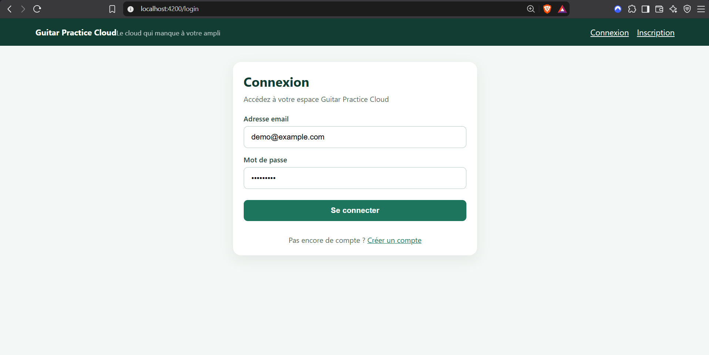
  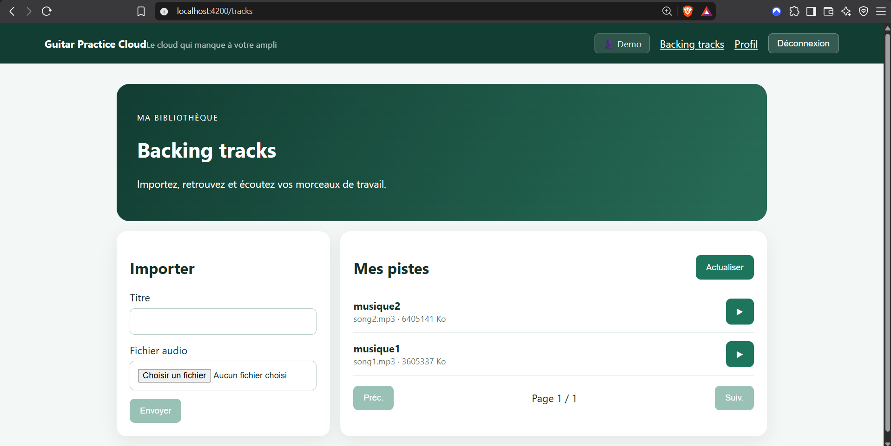

---

### 7. Bouton de déconnexion avec nettoyage de l’état local

- **Objectif** :  
  Permettre à l'utilisateur de mettre fin à sa session à tout moment via un bouton dédié (« Déconnexion »), en purgeant l'intégralité des traces de la session sur la machine (stockage persistant `localStorage`, `sessionStorage`) et en mémoire vive (Signaux Angular `token` et `currentUser`), puis en le redirigeant vers la page publique `/login`.

- **Prompt principal** :  
  > *« je veux que tu m'aides pour faire la partie bouton de déconnexion avec nettoyage de l'etat local dans le fichier sujet_etudiant_tp1.md. J'aimerais que quand on se déconnecte, l'application ne change pas simplement de page mais elle doit effacer toutes les traces de la session de l'utilisateur stockées sur la machine dans le navigateur»*

- **Plan proposé par l'agent** :  
  1. Dans [`AuthService`](frontend-starter/src/app/shared/services/auth.service.ts), centraliser l'effacement complet au sein de la méthode `logout()` :
     - Supprimer la clé du jeton : `localStorage.removeItem(TOKEN_STORAGE_KEY)`.
     - Vider tout stockage temporaire éventuel : `sessionStorage.clear()`.
     - Réinitialiser l'état réactif d'Angular : `this.token.set(null)` et `this.currentUser.set(null)`.
  2. Placer le bouton de déconnexion dans l'en-tête de navigation ([`app.html`](frontend-starter/src/app/components/app/app.html)) conditionné par `@if (auth.token())`, ainsi que sur la page de profil ([`profile-page.html`](frontend-starter/src/app/components/profile-page/profile-page.html)).
  3. Relier le clic `(click)="logout()"` dans [`AppComponent`](frontend-starter/src/app/components/app/app.ts) et [`ProfilePageComponent`](frontend-starter/src/app/components/profile-page/profile-page.ts) pour appeler `this.auth.logout()` puis déclencher la redirection : `void this.router.navigateByUrl('/login')`.
  4. Réutiliser ce même mécanisme de déconnexion automatique lors de la réception d'une erreur HTTP 401 dans [`authInterceptor`](frontend-starter/src/app/shared/interceptors/auth.interceptor.ts) ou lors de la suppression de compte (`deleteAccount()`).

- **Vérifications réalisées par le binôme** :  
  - **Test du clic de déconnexion** : Connexion préalable avec le compte de démonstration, puis clic sur le bouton « Déconnexion » dans la barre supérieure.
  - **Vérification du stockage (DevTools)** : Onglet **Application > Storage > Local Storage** : la clé `gpc_token` disparaît instantanément.
  - **Vérification de l'état en mémoire** : Le nom de l'utilisateur (`👤 Demo`) et les liens « Backing tracks » / « Profil » disparaissent immédiatement de la barre de navigation pour laisser place aux liens « Connexion » et « Inscription ».
  - **Test de protection des routes (Guard)** : Tentative de retour en arrière avec le bouton précédent du navigateur ou saisie manuelle de `http://localhost:4200/tracks` : le guard [`authGuard`](frontend-starter/src/app/shared/guards/auth.guard.ts) intercepte l'absence de token et renvoie automatiquement vers `/login`.

- **Erreurs ou propositions rejetées** :  
  - Rejet d'une simple redirection `router.navigateByUrl('/login')` sans purger le `localStorage` : la session réapparaîtrait au moindre rafraîchissement F5.
  - Rejet de l'utilisation de `window.location.reload()` pour forcer la déconnexion : la purge explicite des Signals et du stockage respecte l'architecture SPA sans rechargement brutal de la page.

- **Fichiers effectivement modifiés** :  
  - [`frontend-starter/src/app/shared/services/auth.service.ts`](frontend-starter/src/app/shared/services/auth.service.ts) : méthode `logout()` assurant le nettoyage complet de `localStorage`, `sessionStorage`, `token` et `currentUser`.
  - [`frontend-starter/src/app/components/app/app.html`](frontend-starter/src/app/components/app/app.html) & [`frontend-starter/src/app/components/app/app.ts`](frontend-starter/src/app/components/app/app.ts) : bouton de déconnexion dans la barre de navigation et méthode `logout()`.
  - [`frontend-starter/src/app/components/profile-page/profile-page.html`](frontend-starter/src/app/components/profile-page/profile-page.html) & [`frontend-starter/src/app/components/profile-page/profile-page.ts`](frontend-starter/src/app/components/profile-page/profile-page.ts) : bouton secondaire de déconnexion dans l'en-tête du profil.

- **Preuve de fonctionnement** :  
  - Clé `gpc_token` effacée du Local Storage à la déconnexion.
  - Réinitialisation instantanée de l'en-tête et redirection immédiate vers `/login`.
  - Blocage effectif de l'accès aux pages protégées après déconnexion.

  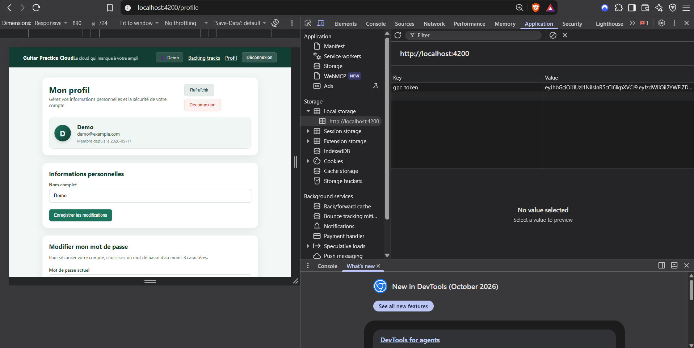
  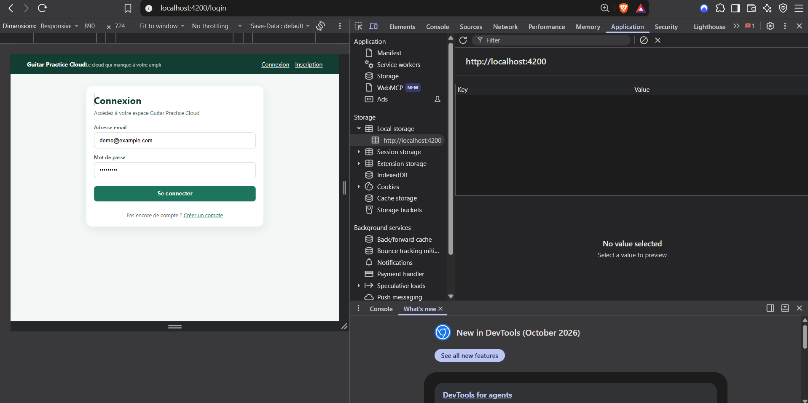

---

### 8. Chargement de `/api/users/me` lorsque le profil est demandé

- **Objectif** :  
  Permettre à l'utilisateur de charger ses informations personnelles fraîches depuis la base de données MongoDB en effectuant une requête HTTP `GET /api/users/me` protégée par le jeton JWT, dès l'affichage de la page de profil (`/profile`) ou lors d'un clic sur le bouton « Rafraîchir ».

- **Prompt principal** :  
  > *« je veux que tu me fasse la partie chargement de `/api/users/me` lorsque le profil est demandé dans le fichier sujet_etudiant_tp1.md. J'aimerais que lorsque l'utilisateur veut voir son profil, le frontend doit utiliser une requête HTTP GET vers /api/users/me au backend pour récupérer ses informations personnelles depuis la base de données »*

- **Plan proposé par l'agent** :  
  1. Dans [`AuthService`](frontend-starter/src/app/shared/services/auth.service.ts), implémenter la méthode `profile()` qui émet la requête `GET /api/users/me` avec `HttpClient` et met à jour automatiquement le Signal `currentUser` via `tap((user) => this.currentUser.set(user))`.
  2. Vérifier que [`authInterceptor`](frontend-starter/src/app/shared/interceptors/auth.interceptor.ts) intercepte bien cette requête pour y injecter l'en-tête `Authorization: Bearer <token>`.
  3. Dans [`ProfilePageComponent`](frontend-starter/src/app/components/profile-page/profile-page.ts) :
     - Implémenter le hook de cycle de vie `ngOnInit()` pour déclencher `this.load()` dès l'ouverture de la page.
     - Ajouter des signaux d'état dédiés : `profileLoading = signal(false)` et `profileError = signal('')`.
     - Dans `load()`, souscrire à `this.auth.profile()` pour alimenter le formulaire (`nameForm.setValue({ name: user.name })`), et gérer les erreurs de connexion éventuelles.
  4. Dans [`profile-page.html`](frontend-starter/src/app/components/profile-page/profile-page.html) :
     - Remplacer le contenu statique par les données réactives de l'utilisateur (`user.name`, `user.email`, `user.createdAt`, avatar dynamique).
     - Relier le bouton « Rafraîchir » à `load()` en le désactivant (`[disabled]="profileLoading()"`) et en affichant un retour textuel pendant le chargement.
     - Afficher une bannière d'erreur conditionnelle `@if (profileError())` en cas d'échec de communication.

- **Vérifications réalisées par le binôme** :  
  - **Inspection Réseau (Network tab)** :  
    - Navigation vers `http://localhost:4200/profile` : émission instantanée de `GET /api/users/me`.
    - Présence de l'en-tête de requête : `Authorization: Bearer <token>`.
    - Code statut HTTP retourné par Express : `200 OK`.
    - Corps JSON de la réponse : `{ "id": "...", "name": "...", "email": "...", "createdAt": "..." }`.
  - **Affichage dynamique dans le DOM** : L'avatar circulaire prend la première lettre du prénom en majuscule, l'email et la date d'adhésion s'affichent correctement, et le champ « Nom complet » est prérempli avec la valeur issue de MongoDB.
  - **Bouton Rafraîchir** : Un clic sur « Rafraîchir » déclenche une nouvelle requête `GET /api/users/me` visible dans les DevTools avec bascule temporaire du bouton à l'état `Chargement...`.

- **Erreurs ou propositions rejetées** :  
  - Rejet du stockage des informations de profil complètes uniquement dans le JWT : le jeton ne doit contenir que le strict minimum (`sub`, `email`) et n'est pas actualisé si le nom change en base. Une requête `GET /api/users/me` garantit des données toujours fraîches.
  - Rejet de l'appel direct de `HttpClient` dans `ProfilePageComponent` afin de respecter la séparation claire entre composants et services.

- **Fichiers effectivement modifiés** :  
  - [`frontend-starter/src/app/shared/services/auth.service.ts`](frontend-starter/src/app/shared/services/auth.service.ts) : méthode `profile()` avec `HttpClient.get<User>('/api/users/me')`.
  - [`frontend-starter/src/app/components/profile-page/profile-page.ts`](frontend-starter/src/app/components/profile-page/profile-page.ts) : signaux `profileLoading` et `profileError`, méthode `load()` et hook `ngOnInit()`.
  - [`frontend-starter/src/app/components/profile-page/profile-page.html`](frontend-starter/src/app/components/profile-page/profile-page.html) : affichage dynamique des données, gestion du bouton de rafraîchissement et bannières d'alerte.

- **Preuve de fonctionnement** :  
  - Requête `GET /api/users/me` réussie avec statut 200 visible dans l'onglet Réseau des DevTools.
  - Données du profil pré-remplies et synchronisées en temps réel avec MongoDB.

  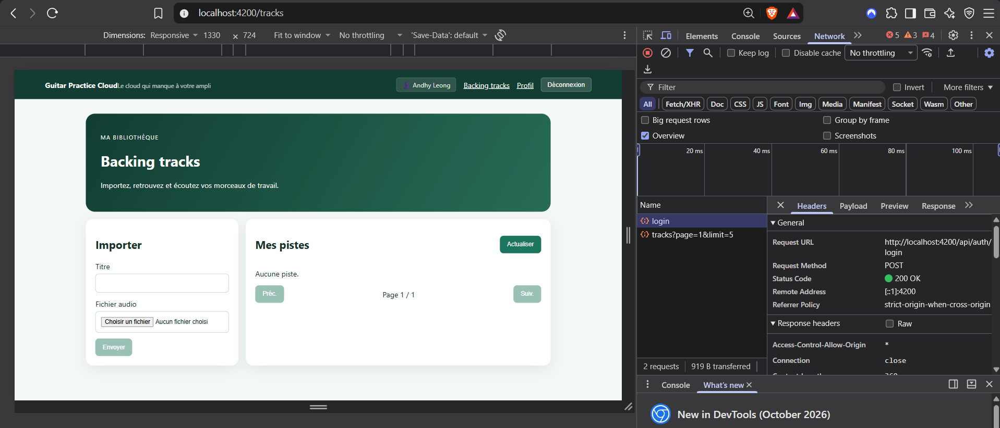

---

### 9. Modification du nom avec `PUT /api/users/me`

- **Objectif** :  
  Permettre à l'utilisateur de modifier son nom complet depuis son profil en émettant une requête HTTP `PUT /api/users/me` vers le backend Express, enregistrer la nouvelle valeur dans la base MongoDB, et mettre à jour l'affichage en temps réel sur la page profil et dans la barre de navigation sans rechargement de page.

- **Prompt principal** :  
  > *« je veux que tu me fasses la partie modification du nom avec `PUT /api/users/me` dans le fichier sujet_etudiant_tp1.md. Je veux que l'utilisateur doit pouvoir modifier son nom complet depuis son profil et que cette modification doit être envoyé au backend grace a une requête HTTP PUT pour enregistrer les modifications dans la base de données afin de l'afficher en temps réel sur la page profil »*

- **Plan proposé par l'agent** :  
  1. Côté Frontend Service ([`AuthService`](frontend-starter/src/app/shared/services/auth.service.ts)) :
     - Implémenter `update(name: string)` émettant `HttpClient.put<User>('/api/users/me', { name })`.
     - Chaîner l'opérateur RxJS `tap((user) => this.currentUser.set(user))` pour synchroniser instantanément le Signal réactif `currentUser` avec l'objet retourné par l'API.
  2. Côté Frontend Composant ([`ProfilePageComponent`](frontend-starter/src/app/components/profile-page/profile-page.ts)) :
     - Déclarer un formulaire réactif `nameForm` avec contrôle `name` (`Validators.required`, `Validators.minLength(2)`).
     - Dans `saveName()`, valider le formulaire, nettoyer la saisie avec `.trim()`, activer l'état de chargement `nameLoading.set(true)`, et appeler `this.auth.update(newName)`.
     - En cas de succès, afficher la confirmation visuelle (`nameMessage`), réinjecter la valeur normalisée et éteindre le spinner.
     - En cas d'erreur (statut 0, 400, etc.), intercepter le retour et afficher un message d'alerte contextualisé (`nameError`).
  3. Côté Frontend Template ([`profile-page.html`](frontend-starter/src/app/components/profile-page/profile-page.html)) :
     - Relier le formulaire à `[formGroup]="nameForm"` et `(ngSubmit)="saveName()"`.
     - Exploiter la réactivité du Signal `auth.currentUser()` pour mettre à jour instantanément le titre `<h2>{{ user.name }}</h2>`, le badge avatar `{{ user.name.charAt(0) }}` et le nom dans l'en-tête global ([`app.html`](frontend-starter/src/app/components/app/app.html)).
  4. Côté Backend ([`backend/src/app.js`](backend/src/app.js)) :
     - Définir le handler `app.put('/api/users/me', auth, ...)` qui extrait `req.auth.sub`, exécute `User.findByIdAndUpdate(req.auth.sub, { $set: { name: req.body?.name } }, { new: true, runValidators: true })`, et répond avec le profil public `user.toPublic()`.

- **Vérifications réalisées par le binôme** :  
  - **Inspection Réseau (Network tab)** :  
    - Modification du nom dans le champ puis clic sur « Enregistrer les modifications ».
    - Émission de la requête HTTP : méthode `PUT`, URL `http://localhost:4200/api/users/me`.
    - En-tête : `Authorization: Bearer <token>`, `Content-Type: application/json`.
    - Corps JSON de la requête : `{ "name": "Valentin F." }`.
    - Statut HTTP reçu : `200 OK`.
    - Corps JSON de la réponse : objet utilisateur complet avec le nouveau `name`.
  - **Réactivité instantanée dans le DOM** : Dès la réception de la réponse 200, le badge avec l'initiale, le titre de l'encart de profil et le bandeau de navigation (`👤 Valentin F.`) changent simultanément sans aucun rafraîchissement d'onglet.
  - **Pérénité dans MongoDB** : Rafraîchissement complet (`F5`) de la page : le nouveau nom reste affiché car la persistance en base de données MongoDB Atlas est effective.

- **Erreurs ou propositions rejetées** :  
  - Rejet de l'envoi d'espaces blancs non nettoyés : ajout du `.trim()` pour éviter d'enregistrer des noms composés uniquement d'espaces.
  - Rejet de la duplication d'état local : le composant profil ne gère pas son propre signal séparé pour le nom ; il délègue la vérité au Signal `AuthService.currentUser`, garantissant une cohérence globale dans toute l'application.

- **Fichiers effectivement modifiés** :  
  - Côté Frontend :  
    - [`frontend-starter/src/app/shared/services/auth.service.ts`](frontend-starter/src/app/shared/services/auth.service.ts) (méthode `update`)
    - [`frontend-starter/src/app/components/profile-page/profile-page.ts`](frontend-starter/src/app/components/profile-page/profile-page.ts) (gestion du formulaire et méthode `saveName`)
    - [`frontend-starter/src/app/components/profile-page/profile-page.html`](frontend-starter/src/app/components/profile-page/profile-page.html) (formulaire de nom, alertes et affichage réactif)
  - Côté Backend (vérifié) :  
    - [`backend/src/app.js`](backend/src/app.js) (route `app.put('/api/users/me')`)
    - [`backend/src/models/User.js`](backend/src/models/User.js) (schéma Mongoose `name`)

- **Preuve de fonctionnement** :  
  - Requête HTTP `PUT /api/users/me` visible avec code 200 dans l'onglet Network.
  - Message de succès vert « Nom modifié avec succès. » affiché sous le champ.
  - Mise à jour immédiate et simultanée du badge avatar, du titre du profil et du header.

  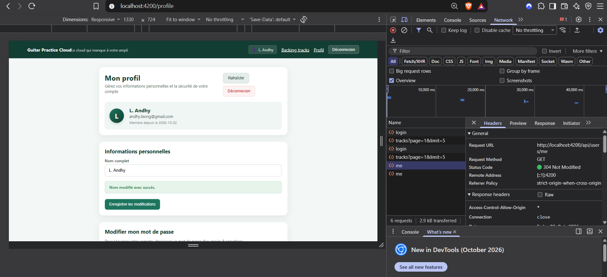

---

### 10. Gestion d’un `401`, avec retour vers `/login` si le token est invalide ou expiré

- **Objectif** :  
  Intercepter de manière globale et transparente toute réponse HTTP `401 Unauthorized` provenant du backend (survenue lors de l'expiration du token après 2h ou en cas de jeton invalide/falsifié), purger l'état de session local (stockage et mémoire) via `AuthService.logout()`, et rediriger automatiquement l'utilisateur vers la page de connexion (`/login`) avec un message d'information explicatif.

- **Prompt principal** :  
  > *« j'aimerais que tu me fasse la partie gestion d’un `401`, avec retour vers `/login` si le token est invalide ou expiré. je veux que si je le token est expiré, ça redirige directement l'utilisateur sur la page de connexion et si l'erreur 401 vient de l'invaliditié du token alors je veux aussi que tu rediriges le client directement dans la page de de connexion»*

- **Plan proposé par l'agent** :  
  1. Dans l'intercepteur HTTP global [`authInterceptor`](frontend-starter/src/app/shared/interceptors/auth.interceptor.ts) :
     - Utiliser l'opérateur RxJS `catchError()` pour capturer toute erreur de type `HttpErrorResponse`.
     - Vérifier la condition : `error.status === 401 && !request.url.includes('/api/auth/login')`. (L'exclusion de `/api/auth/login` évite une boucle de redirection en cas de mot de passe erroné lors de la saisie).
     - Si l'erreur 401 survient (jeton expiré ou signature invalide) :
       - Déclencher le nettoyage complet : `auth.logout()` (suppression de `gpc_token` du `localStorage`, `sessionStorage.clear()`, et remise à `null` des Signaux `token` et `currentUser`).
       - Rediriger automatiquement vers `/login` en passant un paramètre de requête : `void router.navigate(['/login'], { queryParams: { sessionExpired: 'true' } })`.
  2. Dans [`LoginPageComponent`](frontend-starter/src/app/components/login-page/login-page.ts) :
     - Injecter `ActivatedRoute` et initialiser un Signal `sessionExpiredMessage` si le paramètre `sessionExpired` est détecté dans l'URL.
     - Afficher une bannière d'information bleue conviviale dans [`login-page.html`](frontend-starter/src/app/components/login-page/login-page.html) : *« Votre session a expiré ou votre jeton est invalide. Veuillez vous reconnecter. »*.
     - Réinitialiser le message dès qu'une nouvelle tentative de connexion est soumise.
  3. Dans le guard [`authGuard`](frontend-starter/src/app/shared/guards/auth.guard.ts) :
     - Confirmer que l'absence de jeton suite au `logout()` bloque l'accès aux routes protégées et renvoie tout accès direct vers `/login`.

- **Vérifications réalisées par le binôme** :  
  - **Simulation de token falsifié/invalide** :  
    - Modification manuelle du token dans `localStorage` (altération de quelques caractères de la signature JWT via l'onglet Application des DevTools).
    - Tentative de navigation vers `/tracks` ou clic sur « Rafraîchir » dans le profil.
    - Émission de la requête avec le token corrompu → Réponse immédiate du backend Express : `401 Unauthorized` (`{ "message": "Jeton invalide ou expiré" }`).
    - Comportement observé : `authInterceptor` intercepte le 401, purge la session, et redirige instantanément vers `http://localhost:4200/login?sessionExpired=true`.
    - Affichage immédiat de la bannière bleue d'avertissement : *« Votre session a expiré ou votre jeton est invalide. Veuillez vous reconnecter. »*.
  - **Simulation de token expiré** :  
    - Vérification du middleware backend [`backend/src/app.js`](backend/src/app.js#L57-L78) : `jwt.verify(token, SECRET)` lève automatiquement une `TokenExpiredError` après 2 heures, interceptée de la même façon par `authInterceptor`.
  - **Non-interférence avec la page de connexion** :  
    - Saisie d'un mot de passe incorrect sur `/login` : le backend renvoie un 401, mais l'intercepteur ignore cette URL et laisse [`LoginPageComponent`](frontend-starter/src/app/components/login-page/login-page.ts) afficher le message d'erreur rouge approprié (*« Identifiants incorrects »*) sans recharger la page.

- **Erreurs ou propositions rejetées** :  
  - Rejet de la gestion des erreurs 401 au cas par cas dans chaque composant ou service : l'intercepteur HTTP centralise 100% des flux d'erreur réseau en un point unique, évitant tout oubli et toute duplication.
  - Rejet de la redirection brutale sans avertissement à l'utilisateur : le paramètre `sessionExpired=true` et la bannière informative expliquent clairement la raison du retour au formulaire de connexion.

- **Fichiers effectivement modifiés** :  
  - [`frontend-starter/src/app/shared/interceptors/auth.interceptor.ts`](frontend-starter/src/app/shared/interceptors/auth.interceptor.ts) : détection de l'erreur 401, appel de `auth.logout()` et redirection avec query param.
  - [`frontend-starter/src/app/components/login-page/login-page.ts`](frontend-starter/src/app/components/login-page/login-page.ts) : lecture du query param via `ActivatedRoute` et gestion de `sessionExpiredMessage`.
  - [`frontend-starter/src/app/components/login-page/login-page.html`](frontend-starter/src/app/components/login-page/login-page.html) : affichage de la bannière d'information `.alert-info`.
  - [`frontend-starter/src/app/components/login-page/login-page.css`](frontend-starter/src/app/components/login-page/login-page.css) : style visuel de la bannière d'information.

- **Preuve de fonctionnement** :  
  - Erreur 401 visible dans l'onglet Réseau des DevTools.
  - Redirection automatique et immédiate de l'URL vers `/login?sessionExpired=true`.
  - Purge intégrale du `localStorage` et affichage clair de l'alerte invitant à se reconnecter.

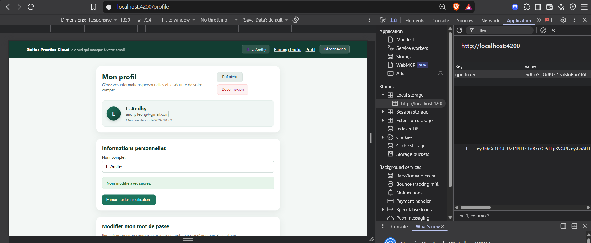
Je change manuellement le gpc_token
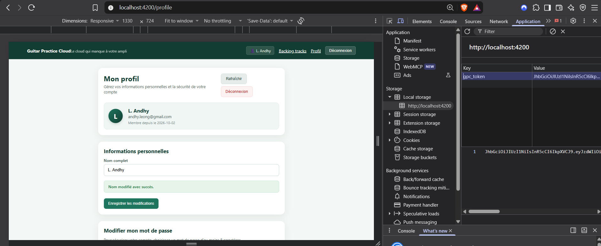
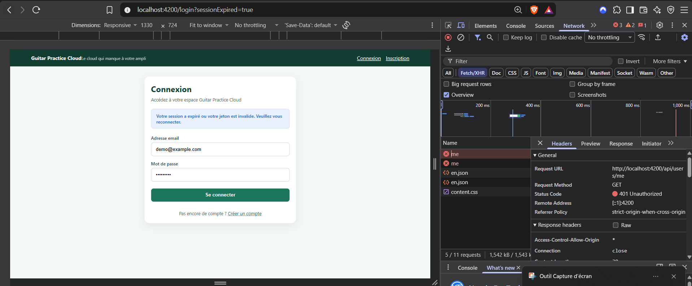

---

# Rapport d'usage de l'IA — TP2

## Mission 2 — Bibliothèque paginée

---

### 1. Bibliothèque paginée et gestion réactive avec Signals

- **Objectif** :  
  Représenter l'état complet de la bibliothèque audio de manière réactive et découplée à l'aide des Angular Signals (`tracks`, `page`, `pages`, `loading`, `error`), afficher uniquement les morceaux de la page courante via la pagination serveur (`GET /api/tracks?page=...&limit=...`), gérer le rendu avec le nouveau Control Flow (`@if`, `@for`, `@empty`) et sécuriser la navigation avec des boutons désactivés aux bornes.

- **Prompt principal** :  
  > *«je travaille actuellement sur le sujet_etudiant_tp2.md. je veux que l'état de l'écran soit réactif et découplé, stocké dans des signals la liste des 'tracks': il faut que ça contient uniquement les morceaux de la page affichés»*

- **Plan proposé par l'agent** :  
  1. Déclarer 5 Signals indépendants dans [`TracksPageComponent`](frontend-starter/src/app/components/tracks-page/tracks-page.ts) :
     - `readonly tracks = signal<Track[]>([])` pour contenir strictement les morceaux de la page active.
     - `readonly page = signal(1)` pour mémoriser l'index de page courante.
     - `readonly pages = signal(1)` pour refléter le total de pages calculé par le serveur.
     - `readonly loading = signal(false)` pour le statut de chargement asynchrone.
     - `readonly error = signal<string | null>(null)` pour capturer et afficher un échec éventuel de l'appel HTTP.
  2. Ajuster la méthode `load()` :
     - Réinitialiser l'erreur (`this.error.set(null)`) et activer le chargement (`this.loading.set(true)`).
     - Appeler `TrackService.list(this.page(), 5)` qui émet une requête HTTP avec `?page=...&limit=5`.
     - À la réception du résultat (`next`), mettre à jour `tracks`, `pages` et repasser `loading` à `false`.
     - En cas d'erreur (`error`), affecter un message compréhensible à `this.error` et couper `loading`.
  3. Sécuriser la méthode `go(page)` avec un contrôle aux bornes (`1 <= page <= pages()`) avant d'émettre la nouvelle requête.
  4. Mettre à jour le template HTML ([`tracks-page.html`](frontend-starter/src/app/components/tracks-page/tracks-page.html)) :
     - Consommer les signaux par appel direct `tracks()`, `page()`, `pages()`, `loading()`, `error()`.
     - Utiliser `@if (loading())`, `@if (error())`, `@for (track of tracks(); track track.id)` et `@empty`.
     - Désactiver les boutons de pagination aux bornes : `[disabled]="page() === 1"` et `[disabled]="page() >= pages()"`.
  5. Ajouter le style CSS pour la bannière d'erreur `.alert-error` dans [`tracks-page.css`](frontend-starter/src/app/components/tracks-page/tracks-page.css).

- **Vérifications réalisées par le binôme** :  
  - Observation des requêtes dans l'onglet Network : à chaque clic sur « Suivant » ou « Précédent », une requête ciblée `GET /api/tracks?page=X&limit=5` est bien émise.
  - Vérification de la liste `tracks()` : elle ne contient que les 5 pistes de la page active, aucun découpage local par `.slice()` n'est effectué.
  - Test des boutons bornés : « Précédent » est désactivé sur la page 1 ; « Suivant » est désactivé sur la dernière page.
  - Test de l'état vide : si aucune piste n'existe, le bloc `@empty` affiche « Aucune piste. ».
  - Test de l'indicateur d'erreur : en cas de coupure de l'API ou de panne réseau, la bannière `.alert-error` s'affiche avec le message du Signal `error()`.

- **Erreurs ou propositions rejetées** :  
  - Rejet de la pagination côté client (charger toutes les pistes et découper en local dans Angular) : formellement interdite par le sujet car elle sature la mémoire et le réseau en cas de volumétrie importante.
  - Rejet de l'utilisation de `BehaviorSubject` ou de directives structurelles obsolètes (`*ngIf`, `*ngFor`) au profit du Control Flow natif (`@if`, `@for`) et des Signals Angular modernes.

- **Fichiers effectivement modifiés** :  
  - [`frontend-starter/src/app/components/tracks-page/tracks-page.ts`](frontend-starter/src/app/components/tracks-page/tracks-page.ts)
  - [`frontend-starter/src/app/components/tracks-page/tracks-page.html`](frontend-starter/src/app/components/tracks-page/tracks-page.html)
  - [`frontend-starter/src/app/components/tracks-page/tracks-page.css`](frontend-starter/src/app/components/tracks-page/tracks-page.css)

- **Preuve de fonctionnement** :  
  - Requêtes HTTP `GET /api/tracks?page=...&limit=5` observées dans l'inspecteur réseau.
  - Mise à jour réactive sans rechargement de page.
  - Désactivation fluide des boutons aux bornes et affichage propre de l'état de chargement et des erreurs.

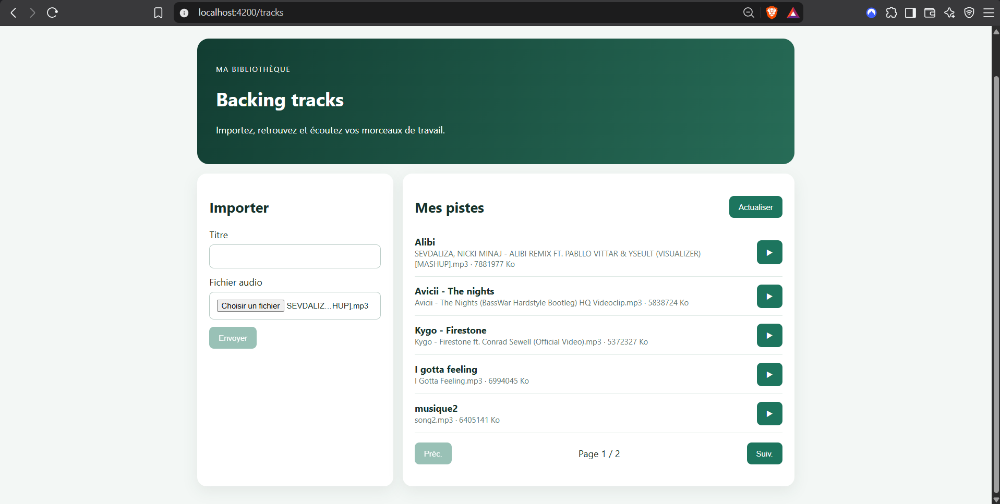

---

### 2. Représentation réactive de la page courante `page` avec un Signal

- **Objectif** :  
  Gérer l'index de pagination de manière réactive à l'aide d'un Signal Angular `readonly page = signal(1)`, afin de synchroniser dynamiquement la valeur courante avec la requête HTTP `GET /api/tracks?page=...&limit=5`, d'afficher le numéro de page dans le template et de désactiver automatiquement les boutons « Précédent » et « Suivant » aux bornes.

- **Prompt principal** :  
  > *« je veux que pour la partie où il faut représenter avec des signals la page courante 'page', tu  stocks le numéro de la page active dans une variable réactive afin de transmettre dynamiquement sa valeur au paramètre de requête HTTP. Je veux que tu fasses cela pour que la template puisse réagir instantanément  pour afficher le numéro de page actuel et désactiver automatiquement les boutons précédent et suivant aux bornes »*

- **Plan proposé par l'agent** :  
  1. Déclarer le Signal `readonly page = signal(1)` dans [`TracksPageComponent`](frontend-starter/src/app/components/tracks-page/tracks-page.ts) pour suivre l'état de la page active.
  2. Transmettre sa valeur réactive `this.page()` dans l'appel `this.service.list(this.page())` afin d'émettre la requête HTTP paginée vers l'API.
  3. Mettre en place la méthode `go(page: number)` pour mettre à jour le signal (`this.page.set(page)`) et relancer `load()` uniquement si la cible est valide (`1 <= page <= pages()`).
  4. Lier le Signal dans le template [`tracks-page.html`](frontend-starter/src/app/components/tracks-page/tracks-page.html) pour afficher `Page {{ page() }} / {{ pages() }}` et conditionner la désactivation des boutons aux bornes : `[disabled]="page() <= 1"` et `[disabled]="page() >= pages()"`.

- **Vérifications réalisées par le binôme** :  
  - Vérification de l'état initial : sur la page 1, le bouton « Précédent » est bien désactivé (`disabled`).
  - Clic sur « Suivant » : la méthode `go(page() + 1)` incrémente `page` à 2, déclenchant une requête `GET /api/tracks?page=2&limit=5` et l'affichage immédiat de `Page 2 / X`.
  - Clic jusqu'à la dernière page : dès que `page() >= pages()`, le bouton « Suivant » se désactive automatiquement.
  - Inspection réseau DevTools : chaque pagination émet une nouvelle requête ciblée sans rechargement de page.

- **Erreurs ou propositions rejetées** :  
  - Rejet d'une simple variable primitive `page = 1` sans Signal : le template ne bénéficierait pas de la réactivité fine d'Angular et nécessiterait des cycles de détection de changement globaux.
  - Rejet de l'utilisation de `page() === 1` au profit de `page() <= 1` pour éviter tout état incohérent aux bornes.

- **Fichiers effectivement modifiés** :  
  - [`frontend-starter/src/app/components/tracks-page/tracks-page.ts`](frontend-starter/src/app/components/tracks-page/tracks-page.ts)
  - [`frontend-starter/src/app/components/tracks-page/tracks-page.html`](frontend-starter/src/app/components/tracks-page/tracks-page.html)

- **Preuve de fonctionnement** :  
  - Désactivation automatique et visuelle des boutons « Précédent » et « Suivant » aux bornes `1` et `pages()`.
  - Affichage en temps réel du compteur `Page {{ page() }} / {{ pages() }}` dans le template.
  - Requêtes HTTP envoyées avec le paramètre `?page=X` correspondant à la page active.
  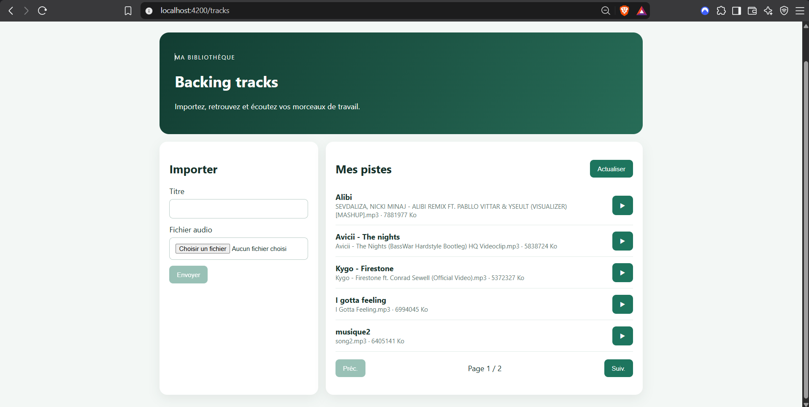

---

### 3. Représentation réactive du nombre total de pages `pages` avec un Signal

- **Objectif** :  
  Représenter le nombre total de pages à l'aide d'un Signal Angular `readonly pages = signal(1)`, synchroniser sa valeur à chaque réponse HTTP renvoyée par le serveur (`this.pages.set(response.pages)`), afficher dynamiquement ce total dans le template (`Page {{ page() }} / {{ pages() }}`) et désactiver automatiquement les boutons de pagination « Précédent » et « Suivant » aux bornes.

- **Prompt principal** :  
  > *« je veux que pour la partie où il faut représenter avec des signals le nombre total de pages 'pages', tu stockes la valeur calculée et renvoyée par le serveur dans une variable réactive mise à jour à chaque réponse HTTP. Je veux que tu fasses ça pour permettre au template d'afficher dynamiquement le nombre total de pages et de désactiver aussi les boutons précédents et suivant »*

- **Plan proposé par l'agent** :  
  1. Déclarer le Signal `readonly pages = signal(1)` dans [`TracksPageComponent`](frontend-starter/src/app/components/tracks-page/tracks-page.ts) pour suivre le total de pages disponibles.
  2. Dans la méthode `load()`, mettre à jour ce Signal lors de chaque réponse HTTP réussie via `this.pages.set(response.pages)`.
  3. Exploiter la valeur de `pages()` dans la méthode `go(page: number)` pour interdire tout changement de page au-delà du maximum autorisé (`page > this.pages()`).
  4. Dans le template [`tracks-page.html`](frontend-starter/src/app/components/tracks-page/tracks-page.html), afficher `Page {{ page() }} / {{ pages() }}` et conditionner la désactivation du bouton « Suivant » avec `[disabled]="page() >= pages()"` ainsi que le bouton « Précédent » avec `[disabled]="page() <= 1"`.

- **Vérifications réalisées par le binôme** :  
  - Observation du template lors du chargement : si la base contient 7 morceaux avec une limite de 5 par page, le backend renvoie `pages: 2`, et le template affiche directement `Page 1 / 2`.
  - Vérification du bouton « Suivant » : actif tant que `page() < pages()`, puis automatiquement désactivé dès que la dernière page est atteinte (`page() === pages()`).
  - Cas d'une seule page (`pages() === 1`) : les deux boutons « Précédent » (`1 <= 1`) et « Suivant » (`1 >= 1`) sont simultanément désactivés.
  - Ajout d'un morceau via `upload()` : réinitialisation sur la page 1 et recalcul immédiat de `pages` par le serveur reflété dans l'interface sans rechargement.

- **Erreurs ou propositions rejetées** :  
  - Rejet d'un calcul local du nombre de pages côté frontend (`Math.ceil(tracks().length / limit)`) : ce calcul serait erroné car `tracks()` ne contient que les pistes de la page courante et non l'ensemble de la base de données.
  - Rejet de l'utilisation d'une propriété simple non réactive : un signal garantit que la mise à jour de `pages` déclenche immédiatement le rafraîchissement des boutons et de l'affichage dans le DOM.

- **Fichiers effectivement modifiés** :  
  - [`frontend-starter/src/app/components/tracks-page/tracks-page.ts`](frontend-starter/src/app/components/tracks-page/tracks-page.ts)
  - [`frontend-starter/src/app/components/tracks-page/tracks-page.html`](frontend-starter/src/app/components/tracks-page/tracks-page.html)

- **Preuve de fonctionnement** :  
  - Réactivité instantanée de l'affichage `Page {{ page() }} / {{ pages() }}` dès la réception du payload JSON `{ items: [...], total: X, pages: Y }`.
  - Boutons de pagination correctement désactivés aux deux bornes (`page() <= 1` et `page() >= pages()`).
  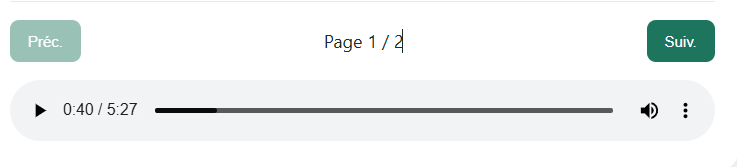

---

### 4. Représentation réactive de l'état de chargement `loading` avec un Signal

- **Objectif** :  
  Créer un indicateur d'état booléen réactif à l'aide d'un Signal Angular `readonly loading = signal(false)`, passant à `true` dès le déclenchement de la requête HTTP et revenant systématiquement à `false` à la réception de la réponse ou lors d'une erreur, afin d'afficher un retour visuel clair informant l'utilisateur pendant l'attente des données et de désactiver les interactions concurrentes.

- **Prompt principal** :  
  > *« je veux que pour la partie où il faut représenter avec des signal l'état de chargelent 'loading', tu crées un booleen qui passe à true dès le lancement de la requete et revient à false dès la reception de la reponse ou d'une erreur. je veux avoir une affichage qui va informer l'utilisateur oendant l'attente des données »*

- **Plan proposé par l'agent** :  
  1. Déclarer le Signal `readonly loading = signal(false)` dans [`TracksPageComponent`](frontend-starter/src/app/components/tracks-page/tracks-page.ts).
  2. Dans la méthode `load()`, activer le signal avec `this.loading.set(true)` juste avant l'appel à `this.service.list(...)`.
  3. Dans le callback `next`, repasser le signal à `false` via `this.loading.set(false)` après l'assignation des données.
  4. Dans le callback `error`, repasser impérativement le signal à `false` via `this.loading.set(false)` pour éviter que l'interface ne reste bloquée en cas de panne réseau.
  5. Dans le template [`tracks-page.html`](frontend-starter/src/app/components/tracks-page/tracks-page.html), afficher un message d'information conditionné par `@if (loading())` et désactiver les boutons de navigation et d'actualisation (`[disabled]="loading()"`).
  6. Styliser l'indicateur `.loading-state` dans [`tracks-page.css`](frontend-starter/src/app/components/tracks-page/tracks-page.css).

- **Vérifications réalisées par le binôme** :  
  - Clic sur « Actualiser » ou sur un bouton de pagination : le texte « Chargement des pistes en cours… » s'affiche immédiatement.
  - Les boutons « Actualiser », « Préc. » et « Suiv. » sont temporairement désactivés pendant le transit réseau, évitant les clics intempestifs et les requêtes en doublon.
  - Dès réception de la réponse 200, le message de chargement disparaît pour laisser place à la liste des pistes.
  - En simulant une coupure réseau (mode Offline dans les DevTools) : le message de chargement disparaît et laisse place à la bannière d'erreur rouge, confirmant que le signal repasse bien à `false` dans le bloc `error`.

- **Erreurs ou propositions rejetées** :  
  - Rejet de l'oubli de `loading.set(false)` dans le bloc `error` : l'application afficherait indéfiniment « Chargement… » sans avertir l'utilisateur d'un échec.
  - Rejet d'un spinner bloquant tout l'écran : le retour contextuel ciblé dans la carte « Mes pistes » offre une meilleure ergonomie sans masquer le formulaire d'envoi.

- **Fichiers effectivement modifiés** :  
  - [`frontend-starter/src/app/components/tracks-page/tracks-page.ts`](frontend-starter/src/app/components/tracks-page/tracks-page.ts)
  - [`frontend-starter/src/app/components/tracks-page/tracks-page.html`](frontend-starter/src/app/components/tracks-page/tracks-page.html)
  - [`frontend-starter/src/app/components/tracks-page/tracks-page.css`](frontend-starter/src/app/components/tracks-page/tracks-page.css)

- **Preuve de fonctionnement** :  
  - Message « Chargement des pistes en cours… » affiché dynamiquement via `@if (loading())`.
  - Boutons désactivés de manière réactive pendant la durée exacte de la requête HTTP.
  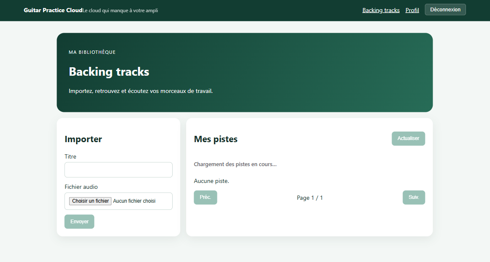

---

### 5. Représentation réactive de l'erreur éventuelle avec un Signal

- **Objectif** :  
  Représenter l'état d'erreur de manière réactive à l'aide d'un Signal Angular `readonly error = signal<string | null>(null)`, réinitialisé à `null` à chaque nouveau chargement et valorisé par un message contextualisé en cas d'échec de la requête HTTP, afin d'afficher instantanément une bannière d'alerte sans interrompre l'expérience utilisateur ni faire planter l'application.

- **Prompt principal** :  
  > *« je veux que tu me fasses la partie où je dois représenter avec des sig,ales l'erreur éventuelle en stockant un message d'erreur, reinitialisé à null au début de chaque chargement et valorisé en cas d'échec de la requête HTTP pour permettre d'afficher instantanément une bannière d'alerte explicative pour informer l'utilisateur sans faire buger l'application »*

- **Plan proposé par l'agent** :  
  1. Déclarer le Signal `readonly error = signal<string | null>(null)` dans [`TracksPageComponent`](frontend-starter/src/app/components/tracks-page/tracks-page.ts).
  2. Au début de `load()`, purger systématiquement l'état d'erreur précédent : `this.error.set(null)`.
  3. Dans le callback `error` de `this.service.list(...).subscribe(...)` :
     - Intercepter l'objet typé `HttpErrorResponse`.
     - Générer un message adapté selon la cause (ex. serveur éteint ou panne réseau statut 0 vs erreur retournée par l'API `error.error?.message`).
     - Affecter le message au signal via `this.error.set(message)`.
     - Désactiver le chargement `this.loading.set(false)`.
  4. Dans le template [`tracks-page.html`](frontend-starter/src/app/components/tracks-page/tracks-page.html), afficher la bannière d'alerte via `@if (error()) { 
{{ error() }}
 }`.

- **Vérifications réalisées par le binôme** :  
  - Simulation de panne serveur (arrêt temporaire du backend ou case Offline cochée dans l'onglet Network des DevTools) :
    - Clic sur « Actualiser » : la bannière d'alerte rouge `Serveur inaccessible. Vérifiez votre connexion ou l’état du backend.` s'affiche immédiatement.
    - L'application reste stable, sans page blanche ni crash Angular.
  - Rétablissement de la connexion et nouveau clic sur « Actualiser » :
    - L'erreur est instantanément effacée (`this.error.set(null)`), le chargement s'exécute et la liste s'affiche dès la réponse 200.

- **Erreurs ou propositions rejetées** :  
  - Rejet du blocage global de l'interface ou de la levée d'exceptions non interceptées (`throw error`) : l'interception gracieuse avec message réactif préserve la navigation.
  - Rejet de l'oubli de réinitialiser l'erreur à `null` au début de chaque tentative : l'ancienne erreur persisterait à l'écran même lors d'une tentative réussie.

- **Fichiers effectivement modifiés** :  
  - [`frontend-starter/src/app/components/tracks-page/tracks-page.ts`](frontend-starter/src/app/components/tracks-page/tracks-page.ts)
  - [`frontend-starter/src/app/components/tracks-page/tracks-page.html`](frontend-starter/src/app/components/tracks-page/tracks-page.html)
  - [`frontend-starter/src/app/components/tracks-page/tracks-page.css`](frontend-starter/src/app/components/tracks-page/tracks-page.css)

- **Preuve de fonctionnement** :  
  - Bannière rouge `.alert-error` affichée dynamiquement dès la réception d'une erreur HTTP.
  - Disparition automatique de la bannière dès qu'une nouvelle requête est lancée avec succès.
  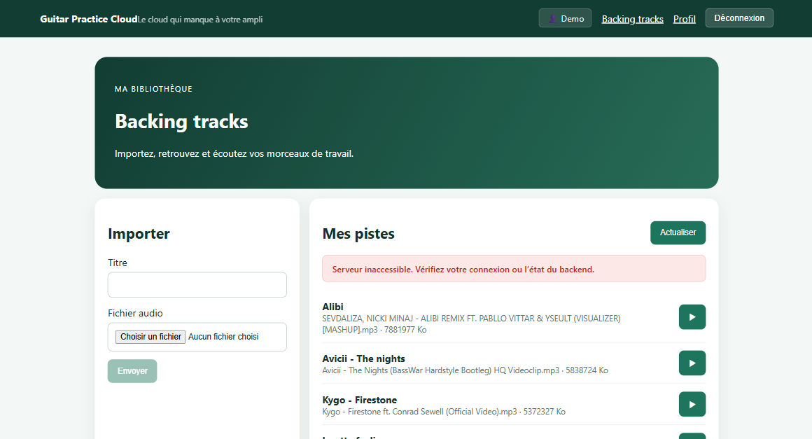

---

### 6. Intégration avancée du composant MatPaginator d'Angular Material

- **Objectif** :  
  Intégrer le composant graphique officiel `<mat-paginator>` issu de `@angular/material/paginator` pour enrichir la pagination de la bibliothèque audio avec le choix de taille de page (5, 10, 20), l'affichage du total d'éléments et la navigation accessible, tout en reliant ses événements à la logique réactive par Signals.

- **Prompt principal** :  
  > *« j'aimerais que dans la page tu me rajoutes le composant paginator de la biblithèque graphique angular material comme ça : https://material.angular.dev/components/paginator/overview »*

- **Plan proposé par l'agent** :  
  1. Installer `@angular/material` et `@angular/cdk` dans `frontend-starter`.
  2. Importer le thème Angular Material (`@angular/material/prebuilt-themes/azure-blue.css`) dans [`src/styles.css`](frontend-starter/src/styles.css).
  3. Importer `MatPaginatorModule` et le type `PageEvent` dans [`TracksPageComponent`](frontend-starter/src/app/components/tracks-page/tracks-page.ts).
  4. Ajouter les Signaux `total = signal(0)` et `limit = signal(5)` alimentés par la réponse de `TrackService.list(this.page(), this.limit())`.
  5. Implémenter le gestionnaire d'événement `onPageChange(event: PageEvent)` pour synchroniser `limit.set(event.pageSize)` et `page.set(event.pageIndex + 1)` (conversion de l'index 0-based de Material vers l'index 1-based de l'API).
  6. Remplacer les boutons manuels par `<mat-paginator>` dans [`tracks-page.html`](frontend-starter/src/app/components/tracks-page/tracks-page.html).

- **Vérifications réalisées par le binôme** :  
  - Observation du composant dans le navigateur : le Paginator Material s'affiche avec le sélecteur « Items per page » (5, 10, 20), l'indicateur de plage (« 1 – 5 of X ») et les flèches directionnelles.
  - Test de changement de taille de page : sélection de « 10 » -> émission d'une requête `GET /api/tracks?page=1&limit=10` et mise à jour instantanée du nombre de pistes affichées.
  - Test de navigation : clic sur page suivante -> passage à l'index Material 1 correspondant à `page = 2` dans la requête backend.
  - Désactivation automatique pendant le chargement : `[disabled]="loading()"` désactive l'ensemble des contrôles du paginator pendant les appels HTTP.

- **Erreurs ou propositions rejetées** :  
  - Rejet de l'incohérence d'indexation : `MatPaginator` utilise une base 0 (`pageIndex: 0, 1, 2...`) alors que l'API MongoDB utilise une base 1 (`page: 1, 2, 3...`). L'oubli de la conversion `+ 1` / `- 1` provoquerait des décalages de page.
  - Rejet de l'omission du thème CSS Material : sans `@import` de thème, le paginator apparaîtrait déstructuré et sans icônes vectorielles.

- **Fichiers effectivement modifiés** :  
  - [`frontend-starter/package.json`](frontend-starter/package.json)
  - [`frontend-starter/src/styles.css`](frontend-starter/src/styles.css)
  - [`frontend-starter/src/app/components/tracks-page/tracks-page.ts`](frontend-starter/src/app/components/tracks-page/tracks-page.ts)
  - [`frontend-starter/src/app/components/tracks-page/tracks-page.html`](frontend-starter/src/app/components/tracks-page/tracks-page.html)

- **Preuve de fonctionnement** :  
  - Composant `mat-paginator` actif et stylisé sur `http://localhost:4200/tracks`.
  - Changement dynamique de page et de taille de page (5, 10, 20) répercuté sur l'API et la liste des pistes.
  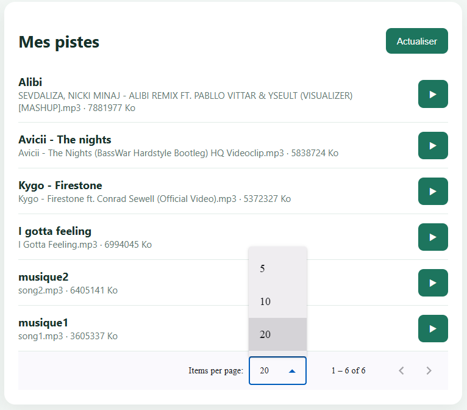

---

### 7. Analyse du transfert audio backend : mémoire vive vs streaming disque

-  Le backend envoie-t-il le fichier entier en mémoire ou peut-il l’envoyer progressivement depuis le disque ?
- --> Le backend ne charge pas le fichier entier en mémoire vive mais l'envoie progressivement depuis le disque  par paquet grâce à un flux de lecture Node.js sur la réponse HTTP

